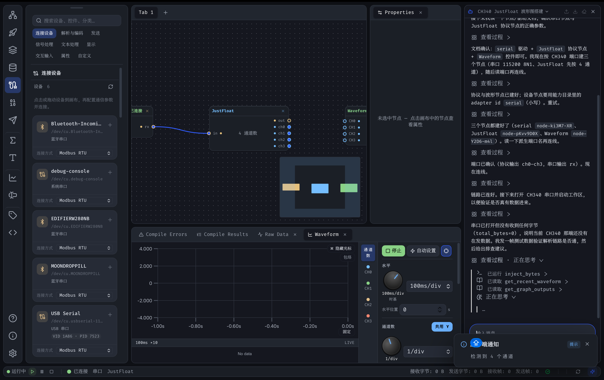

# Lissio

[English](./README.md) | [简体中文](./README.zh-CN.md)

一个使用 Rust + Tauri 完全重构的下一代串口助手 —— 面向嵌入式调试、波形可视化、节点式数据流编排、CAN / 汽车诊断与逻辑分析。

<!-- PROJECT SHIELDS -->

[![Contributors][contributors-shield]][contributors-url]
[![Forks][forks-shield]][forks-url]
[![Stargazers][stars-shield]][stars-url]
[![Issues][issues-shield]][issues-url]
[![GPL v2 License][license-shield]][license-url]

<!-- PROJECT LOGO -->
<br />

<p align="center">
  <a href="https://github.com/horldsence/lissio">
    
  </a>

  <h3 align="center">Lissio</h3>
  <p align="center">
    现代化串口调试工具，支持波形显示、节点编辑器、多协议解析、CAN 诊断与逻辑分析。
    <br />
    <a href="https://github.com/horldsence/lissio"><strong>查看项目仓库 »</strong></a>
    <br />
    <br />
    <a href="https://github.com/horldsence/lissio/issues">报告 Bug</a>
    ·
    <a href="https://github.com/horldsence/lissio/issues">提出新特性</a>
  </p>
</p>



## 目录

- [项目简介](#项目简介)
- [核心特性](#核心特性)
- [使用指引](#使用指引)
- [技术栈](#技术栈)
- [目录结构](#目录结构)
- [开发环境](#开发环境)
- [安装与运行](#安装与运行)
- [构建与打包](#构建与打包)
- [测试](#测试)
- [贡献指南](#贡献指南)
- [版本控制](#版本控制)
- [开源协议](#开源协议)
- [鸣谢](#鸣谢)
- [打赏](#打赏)

## 项目简介

Lissio 是一款面向嵌入式调试场景的桌面串口助手。前端基于 React 19 + TypeScript + Vite，后端由 Rust + Tauri 2 提供高性能传输层 I/O、协议解析、节点图 DAG 引擎、DSP（FIR/IIR 滤波、FFT 频谱）以及汽车诊断协议（ISO-TP / UDS / OBD-II / J1939）。

应用支持 7 种传输方式、7 种协议引擎、基于 React Flow 的节点编辑器数据流编排、示波器式波形显示、CAN 帧 / 负载分析、逻辑分析仪（UART/I2C/SPI 解码），以及运行在沙箱 iframe 中的自定义 JS 控件系统。

界面采用 **Dock 卡片式窗口布局**：控件画布与数据视图以卡片形式自由拆分、合并、停靠，多标签页随时切换，布局状态自动持久化。

## 核心特性

### 传输层

- **串口**（USB-CDC），可配置波特率 / 数据位 / 校验位 / 停止位 / 流控。
- **TCP 客户端** / **TCP 服务端**。
- **UDP**，独立配置本地与远端地址。
- **测试数据** —— 内置信号发生器（正弦 / 方波 / 三角 / 锯齿 / 随机 / 直流 / 扫频 / 阶梯 / 噪声 / 多频叠加），便于离线原型验证。
- **Slcan** —— 串口 CAN。
- **CandleLight** —— 原生 USB CAN 后端。
- 支持自动重连与连接状态通知。

### 协议引擎

- **JustFloat** & **FireWater** —— VOFA+ 协议，支持通道自动检测。
- **RawData** —— 原始字节流查看。
- **Slcan** / **CandleLight** —— CAN 帧解析。
- **LogicDecode** —— 从数字电平采样解码 UART / I2C / SPI 协议。
- **Diagnostic** —— ISO-TP / UDS / OBD-II / J1939 汽车诊断协议栈（基于 `libautomotive`）。

### 节点编辑器与数据流

- 基于 **React Flow** —— 从侧边栏拖拽控件到画布并连接数据流。
- 后端 **DAG 引擎**（`graph` 门面与 `kind/hir/plane/lower/eval` 编译链）将图编译为拓扑序，逐帧评估所有节点输出，含循环检测。
- 节点类型：`ChannelSource`、`Input`、`Math`、`Filter`、`SpectrumSink`、`FrameDecoder`、`Custom`（JS）、`Sink`。
- **算术节点**：加 / 减 / 乘 / 除 / 均值 / 最小 / 最大 / 绝对值 / 取反 / 平方 / 开方 / sin / cos / tan / log。
- **滤波器节点**：低通 / 高通 / 带通 / 带阻（FIR 系数或 IIR biquad），跨帧状态持久化。
- **SpectrumSink**：块运算 FFT，可选窗函数（Hann / Hamming / Blackman / Rect）与输出模式（Magnitude / Power / PSD / dB），由独立 30 FPS ticker 驱动。
- **FrameDecoder**：基于块的字节流解析器（帧头 / 长度 / ID / 字段 / 位域 / 校验 / 帧尾），支持通过 `match_id` 多帧分派与校验和验证。
- **Custom JS 节点**：用户 JavaScript 运行在沙箱 iframe 中，输出回传到后端图。

### 操作历史 · 撤销 / 重做 / 回溯

- **快照式撤销栈** —— 增删节点、连线、控件配置、标签页增删等画布操作自动记录为时间线；会话内有效，最多保留 200 步。
- **快捷键** —— `Ctrl+Z` 撤销、`Ctrl+Y` 重做；拖动节点、滑块调节等连续手势自动合并为一条记录。
- **操作历史面板** —— 时间线列表最新在上，行首徽章沿用画布节点的种类配色（连线显示双端点配色）；点击任意一条直接跳转到那个时刻（快照式回滚），当前条目高亮，其上方灰显的「已撤销 · 可重做」分区点击即可重做。
- **分支语义** —— 回退后继续编辑会自动丢弃 redo 分支；导入备份 / 应用模板后以新基线重置历史。
- **面板入口** —— 数据卡片标题栏「＋」菜单中的「打开操作历史」，或新手引导中实际演练。

### 显示与控件

- **示波器式波形** —— 基于 uPlot，支持时基缩放、游标测量、Run/Stop 冻结、通道 Y 轴独立 / 共享模式、缩略图缩放、十字线、悬停采样点标记、游标吸附。
- **仪表 / LED / 数字显示 / 饼图 / 标签** —— 一眼读数。
- **图像查看器** —— 支持 RGB888 / RGB565 / Gray8 像素格式。
- **频谱图** —— 实时 FFT 可视化。
- **3D 模型查看器** —— 基于 Three.js / React Three Fiber。
- **CAN 帧列表 / CAN 发送器 / CAN 负载视图** —— 支持 CSV 导出与负载告警。
- **逻辑时序图** + 解码事件列表（UART/I2C/SPI）。
- **命令发送器**（含块编辑器）与**帧解码器**手动测试面板。
- **原始数据视图** —— 独立控件，支持网格 / 换行分组、HEX / ASCII 表示、按端口通道切换、时间戳 / 偏移显示与发送面板。
- **自定义控件编辑器** —— 基于 CodeMirror 6 的 JS 编辑器，实时预览。

### 窗口组织与布局

- **活动栏** —— 左侧 VSCode 风格图标导航，一键切换侧边栏视图（数据接口 / 协议引擎 / 控件面板）。
- **可停靠侧边栏** —— 支持停靠在窗口左侧或右侧，拖动标题栏到窗口边缘即可切换；可随时显示 / 隐藏。
- **Dock 卡片式中央区** —— 控件画布与数据视图以可拆分 / 合并的卡片呈现：
  - 拖动标签页到其他卡片的标题栏 → 合并为该卡片的标签页；
  - 拖动标签页到卡片边缘 → 拆分为独立面板；
  - 拖动标题栏空白处 → 整卡移动到其他卡片边缘；
  - 拖动标签页 / 卡片到页面四边 → 停靠为整行 / 整列条带。
  - 布局树与卡片尺寸自动持久化（`vofa-dock`），重启后保持。
- **双标签页体系** —— 控件画布标签页（节点编辑器）与数据标签页（波形 / 原始数据 / CAN / 逻辑分析仪等）可混合编排。
- **状态栏** —— 连接状态、传输 / 协议、RX / TX 字节与帧数、CAN 负载、缓冲区使用率一目了然。
- **多标签页** —— 每个标签页独立命名、重命名、复制、关闭。

### 体验与平台

- VSCode 风格布局：活动栏、侧边栏、可缩放面板、状态栏、多标签页。
- 原生菜单栏（macOS / Windows / Linux）与全局快捷键（`Ctrl+,` 打开设置，菜单含新建 / 关闭标签页、切换侧边栏）。
- **国际化** —— 通过 YAML 管理中文 / 英文界面文案。
- **设置面板** —— 通用 / 外观 / 编辑器 / 数据 / 串口 / 通知，通过 `tauri-plugin-store` 持久化。
- **全应用配置导出 / 导入** —— 通过系统文件对话框将设置、协议、传输、控件、节点图、数据标签页与视图偏好备份为单个 JSON 文件，便于迁移。
- 自定义主题编辑器、引导向导、帮助中心、上下文提示。
- 透明窗口与亚克力 / 毛玻璃效果（macOS）。
- 通过 `tauri-plugin-notification` 的原生系统通知。
- 通过 `tauri-plugin-log` 的结构化日志（stdout / 日志目录 / webview）。

### AI 助手

- **流式 AI 对话** —— 可停靠对话面板(默认右侧,拖动标题栏可重新停靠到左侧 / 底部或浮动为小窗,布局持久化),支持 **Markdown 渲染**(表格、代码高亮、代码块 / 消息一键复制)与多会话管理(新建 / 重命名 / 删除,历史由 Rust 后端持久化,重启不丢)。
- **26+ LLM 服务商** —— OpenAI / Anthropic / Gemini / DeepSeek / 通义 / Kimi / GLM / Ollama / OpenRouter 等,并以 [**OrcaRouter**](https://orcarouter.ai) 为重点推荐的默认适配器(一把 Key 调用全厂商模型,[通过推广链接注册获取 API Key](https://www.orcarouter.ai/ref/ref_1f7582998bdadbe7e0f3)即可支持本项目)。
- **工具调用(MCP 客户端)** —— 对话中模型可调用外部 MCP server(stdio / HTTP)提供的工具,单次调用全程可追踪。
- **MCP 服务(入站)** —— 本应用把自身能力(串口发送、波形读取、节点图编辑…)暴露为 MCP 工具(`http://127.0.0.1:{port}/mcp`),Claude Desktop 等外部 AI 客户端可直接操控 Lissio。

## 使用指引

### 快速上手

1. **配置传输** —— 点击左侧活动栏的「数据接口」图标，在侧边栏选择传输方式（串口 / TCP / UDP / 测试数据 / Slcan / CandleLight），填写参数后点击「连接」。
2. **选择协议** —— 点击「协议引擎」图标，选择与设备匹配的协议（JustFloat / FireWater / RawData / Slcan / CandleLight / LogicDecode）。
3. **搭建数据流** —— 点击「控件」图标打开控件面板，将控件拖入画布并连接到通道源或上游控件，构建节点式数据流。
4. **查看数据** —— 波形等显示控件会自动创建对应的数据标签页；也可点击数据卡片标题栏的「+」手动添加 CAN 帧、逻辑分析仪等标签页。

### 窗口组织

默认布局如下（所有面板均可自由调整）：

```
┌──────────┬──────────────────────────────────────────────┐
│          │  控件画布卡片（标签页 Tab 条 + 节点编辑器）      │
│  活动栏   ├──────────────────────────────────────────────┤
│  (数据接口/ ├──────────────────────────────────────────────┤
│   协议引擎/ │  数据视图卡片（波形 / 原始数据 / CAN / 逻辑…）  │
│   控件面板) │                                              │
│          ├──────────────────────────────────────────────┤
│          │  状态栏：连接状态 · 传输/协议 · RX/TX · 负载     │
└──────────┴──────────────────────────────────────────────┘
```

- **活动栏**（最左侧竖条）—— 点击图标切换侧边栏视图；底部图标可打开帮助中心、关于与设置。
- **侧边栏**（默认左侧）—— 显示当前视图对应的配置面板；拖动标题栏到窗口左 / 右边缘可切换停靠侧；点击活动栏图标或使用菜单「切换侧边栏」可显示 / 隐藏。
- **中央 Dock 区** —— 由若干卡片组成，每张卡片承载一个或多个标签页：
  - **合并**：把一个标签页拖到另一张卡片的标题栏上，松手即合并为它的标签页。
  - **拆分**：把标签页拖到卡片边缘（上 / 下 / 左 / 右），松手拆分为独立面板。
  - **整卡移动**：拖动标题栏空白处，将整张卡片移动到其他卡片边缘。
  - **页面停靠**：把标签页 / 卡片拖到窗口（中央区）四边，停靠为整行或整列条带。
  - **调整尺寸**：拖动卡片之间的分隔条改变占比；所有尺寸与布局自动保存，重启后恢复。
- **状态栏**（底部）—— 显示连接状态、当前传输与协议、RX / TX 字节与帧数、CAN 负载告警、缓冲区使用率，右侧为刷新按钮。

### 标签页管理

- **控件画布标签页** —— 每个标签页是一张独立的节点编辑器画布。标题栏「+」新建；右键标签可重命名 / 复制 / 关闭 / 关闭其他；双击标签名可直接重命名。
- **数据标签页** —— 波形、原始数据、饼图、图像、3D 模型、频谱、命令发送、CAN 帧、逻辑分析仪、表格、帧解码等。数据卡片标题栏的「+」可添加 CAN 帧与逻辑分析仪标签页。
- 标签页可在卡片之间自由拖拽合并 / 拆分，也可通过右键菜单关闭。

### 常用操作

- **设置**：`Ctrl+,` / `Cmd+,` 或活动栏齿轮图标；支持全应用配置导出 / 导入（备份为单个 JSON 文件）。
- **撤销 / 回溯**：`Ctrl+Z` 撤销、`Ctrl+Y` 重做；「操作历史」面板中点击任意一条记录可跳回该时刻（详见核心特性）。
- **刷新端口**：状态栏刷新按钮或右键菜单。
- **帮助与引导**：活动栏底部帮助图标可随时打开帮助中心；首次启动自动弹出引导向导（可在设置中关闭）。

## 技术栈

### 前端

- [React 19](https://react.dev/) + [TypeScript](https://www.typescriptlang.org/) + [Vite 7](https://vitejs.dev/)
- [Tailwind CSS 4](https://tailwindcss.com/)（通过 `@tailwindcss/vite`）
- [React Flow](https://reactflow.dev/)（`@xyflow/react`）—— 节点编辑器
- [uPlot](https://github.com/leeoniya/uPlot) —— 波形图表
- [Three.js](https://threejs.org/) + [`@react-three/fiber`](https://github.com/pmndjs/react-three-fiber) —— 3D 查看器
- [CodeMirror 6](https://codemirror.net/) —— 自定义控件代码编辑器
- [TanStack React Virtual](https://tanstack.com/virtual) —— 虚拟列表
- [react-resizable-panels](https://github.com/bvaughn/react-resizable-panels) —— VSCode 风格布局
- [Zustand](https://github.com/pmndrs/zustand) —— 状态管理
- [lucide-react](https://lucide.dev/icons/) —— 图标
- [YAML](https://github.com/eemeli/yaml) —— 国际化

### 后端

- [Rust](https://www.rust-lang.org/) + [Tauri 2](https://tauri.app/)
- [Tokio](https://tokio.rs/) —— 异步运行时
- [Serde](https://serde.rs/) —— 序列化
- [parking_lot](https://github.com/Amanieu/parking_lot) —— 同步原语
- [window-vibrancy](https://github.com/tauri-apps/window-vibrancy) —— 亚克力 / mica 效果
- [libautomotive](https://crates.io/crates/libautomotive) —— UDS / OBD-II / J1939 诊断
- Tauri 插件：`tauri-plugin-log`、`tauri-plugin-notification`、`tauri-plugin-store`、`tauri-plugin-opener`

### 后端 Workspace 架构

Rust workspace 按责任领域分组，并通过声明的依赖层级约束边界。组合根是 Tauri
桌面壳（`lissio`）、`backend-server` 与 `backend-cli`；产品能力统一进入
`control-api`，命令派发统一进入 `rpc-api`，装配统一进入 `backend-host`。

| 领域 | 结构职责 |
| --- | --- |
| `shared` | 稳定契约：错误、流信封、数据/配置模型、订阅 |
| `signal` | 波形缓冲、原始数据、滤波、频谱、测量、GPU 包络适配器 |
| `vehicle` | CAN 与诊断协议类型 |
| `protocol` | 协议/Schema 引擎、帧解码、逻辑解码、点位、采集契约 |
| `graph` | 节点定义，以及 HIR → 平面投影 → Lower → Eval 编译/运行链 |
| `transport` | 设备树契约，以及串口/网络/CAN/工业协议适配器 |
| `data` | 数据总线与录制存储 |
| `ai` | LLM 客户端、对话/会话状态、MCP 客户端 |
| `desktop` | 数据平面/应用状态、能力核心、RPC 派发、后端装配/服务/CLI、AI 宿主、平台壳 |

完整 crate 清单、依赖层级、领域 DAG 与架构检查见
[`docs/architecture/crates.md`](docs/architecture/crates.md)。

## 目录结构

```text
lissio/
├── docs/architecture/             # 架构契约与设计文档
├── scripts/                       # 架构、契约、构建与发布工具
├── src/                           # React/TypeScript 前端
│   ├── components/                # 控件、显示、布局、节点、面板、AI 界面
│   ├── lib/
│   │   ├── acquisition/           # 设备树与能力投影
│   │   ├── ai/                    # 对话/工具前端集成
│   │   ├── models/                # 模型目录创建与描述消费
│   │   ├── platform/              # Desktop/Web 平台服务 shim
│   │   ├── rpc/                   # Transport 契约、重连与重水合
│   │   └── ...                    # 缓冲、图、快速开始、协议工具
│   ├── store/                     # Zustand store 与状态分片
│   ├── types/
│   │   └── generated/             # 由 Rust/ts-rs 导出的 wire 合同
│   ├── i18n/locales/              # 中英文用户文案
│   ├── App.tsx
│   └── main.tsx
├── src-tauri/
│   ├── crates/<domain>/<crate>    # Rust workspace 成员
│   ├── src/
│   │   ├── shell.rs               # 桌面专属窗口/启动页/设置壳命令
│   │   ├── sidecar.rs             # lissio-server sidecar 生命周期监管与诊断
│   │   ├── lib.rs                 # Tauri 组合根
│   │   └── main.rs
│   ├── Cargo.toml                 # Workspace 与依赖权威来源
│   └── tauri.conf.json
├── packaging/                     # 服务启动与容器打包
├── public/                        # 静态应用资源
├── images/                        # README 图片
├── package.json
├── pnpm-workspace.yaml
└── vite.config.ts
```

## 开发环境

- [Node.js](https://nodejs.org/)（建议 LTS）
- [pnpm](https://pnpm.io/)
- [Rust](https://www.rust-lang.org/tools/install)（stable）
- [Tauri 2 系统依赖](https://tauri.app/start/prerequisites/)
- 如需 CAN 诊断：兼容的 CAN 接口（Slcan 适配器或 CandleLight 兼容 USB 加密狗）

## 安装与运行

1. 克隆仓库

```sh
git clone https://github.com/horldsence/lissio.git
cd lissio
```

2. 安装前端依赖

```sh
pnpm install
```

Lissio 固定为三个独立交付单元：Backend/CLI 压缩包、纯静态 Web 压缩包，以及
内含同版本 `lissio-server` sidecar 的 Desktop 安装包。

### 桌面（Tauri）

```sh
pnpm dev:desktop    # 准备并启动 sidecar、Vite 与原生窗口
pnpm build:desktop  # 打包安装程序 → src-tauri/target/release/bundle/
```

Desktop 的业务调用全部走 HTTP/WebSocket；Tauri IPC 仅保留窗口、菜单、更新器、文件对话框
和 sidecar 管理。sidecar 缺失、鉴权失败、协议不兼容或崩溃时，会在业务 store 挂载前显示连接诊断页。

### 独立 Web 服务（`lissio-server`）

```sh
pnpm build:web                              # 前端 → dist/
pnpm dev:server --static-dir dist           # 单进程同时提供 HTTP API 与网页
```

然后打开 `http://127.0.0.1:8790`。首次访问在地址后追加访问令牌 `?token=<server-token>`
—— 浏览器只在 sessionStorage 中保留令牌，并立即把参数从地址栏摘掉。令牌文件在首次启动时生成，路径会打印到
服务端日志：macOS 为 `~/Library/Application Support/top.pengheng.lissio/server-token`，
Windows 为 `%APPDATA%\top.pengheng.lissio\server-token`，Linux 为
`~/.config/top.pengheng.lissio/server-token`；也可通过 `LISSIO_TOKEN` 显式指定。

| 参数 | 环境变量 | 默认 |
|---|---|---|
| `--bind` | `LISSIO_BIND` | `127.0.0.1` |
| `--http-port` | `LISSIO_HTTP_PORT` | `8790` |
| `--token` / `--token-file` | `LISSIO_TOKEN` | `<配置目录>/server-token`（0600） |
| `--static-dir` | `LISSIO_STATIC_DIR` | 关（仅 API） |
| `--cors-origin`（可重复） | `LISSIO_CORS_ORIGINS` | 关（同源部署） |
| `--mcp-port` / `--no-mcp` | `LISSIO_MCP_PORT` | `8765` / 默认启动 MCP |

暴露到 loopback 之外需 `--bind 0.0.0.0` 并显式提供强令牌。`pnpm server` 等价于
`cd src-tauri && cargo run -p lissio-backend-server`；CLI 形式
`cargo run -p lissio-backend-cli -- serve` 走同一条装配路径。探活：
`curl http://127.0.0.1:8790/api/v1/health`。

AI 对话、会话、外部 MCP、入站 MCP 与前端工具在 Desktop/Web 中功能一致。保存的
Provider Key 不可读回，UI 只接收 `configured`、`source`、`writable` 状态。部署环境变量为
`LISSIO_AI_API_KEY_<ADAPTER>`，例如 `LISSIO_AI_API_KEY_OPENAI`。
Debug 构建会在每次请求时直接读取仓库根目录的 `.env`，不访问系统钥匙串。
可将 `.env.example` 复制为 `.env` 后在本机填写；`.env` 已加入 Git 忽略规则。
Release 构建继续使用系统钥匙串，并保留环境变量回退。

### OCI（server + Web）

```sh
docker run --rm -p 8790:8790 -p 8765:8765 \
  -e LISSIO_TOKEN='请替换为强令牌' \
  -v lissio-data:/var/lib/lissio ghcr.io/horldsence/lissio:latest
```

镜像缺少显式令牌时会拒绝启动；需要硬件访问时通过容器运行时映射串口/CAN 设备。

### Web 前端开发（热更新）

```sh
pnpm dev:server # 终端 1：独立服务端，端口 8790
pnpm dev:web   # 终端 2：vite 开发服务器，端口 1420，/api 自动代理到服务端
```

打开 `http://localhost:1420/?token=<server-token>` 一次即可（令牌写入 sessionStorage）。
需要指向其它后端时设置 `LISSIO_DEV_SERVER=http://host:port`。

## 构建与打包

生成生产环境前端资源并打包桌面应用：

```sh
pnpm build:web
pnpm build:server
pnpm build:desktop
```

输出产物位于 `src-tauri/target/release/bundle/`。

跨平台构建示例（见 `scripts/build.sh`）：

```sh
# Windows 交叉编译
pnpm tauri build --runner cargo-xwin --target x86_64-pc-windows-msvc

# macOS dmg 包
pnpm tauri build --bundles dmg
```

CI 工作流位于 `.github/workflows/`（`build.yml`、`release.yml`）。

## 测试

提交前运行与 CI 相同的完整质量面：

```sh
pnpm architecture
pnpm check:architecture
pnpm check:deps
pnpm check:web-contract
pnpm check:contracts
pnpm check:model-catalog
pnpm typecheck
pnpm lint:ci
pnpm test
pnpm build:web
pnpm test:e2e
cd src-tauri && cargo fmt --check
cd src-tauri && cargo clippy --workspace --all-targets
cd src-tauri && cargo test --workspace
cd src-tauri && cargo deny check
```

局部检查通过不等于完整构建通过；以上命令均属于 CI 质量门禁。

## 贡献指南

贡献使开源社区成为一个学习、激励和创造的绝佳场所。你所作的任何贡献都**非常感谢**。

1. Fork 本项目
2. 创建功能分支：`git checkout -b feature/AmazingFeature`
3. 提交改动：`git commit -m 'Add some AmazingFeature'`
4. 推送到分支：`git push origin feature/AmazingFeature`
5. 提交 Pull Request

提交 PR 前请确保 `pnpm tsc --noEmit` 与 `cd src-tauri && cargo clippy --workspace && cargo test` 均通过。

## 版本控制

本项目使用 Git 进行版本管理。你可以在 [Releases](https://github.com/horldsence/lissio/releases) 页面查看可用版本。

## 开源协议

本项目仅基于 GNU GPL v2 协议开源，详情请参阅 [LICENSE](./LICENSE)。

## 鸣谢

- [VOFA+](https://www.vofa.plus/) 提供的 FireWater / JustFloat 协议参考
- [Tauri](https://tauri.app/)
- [React Flow](https://reactflow.dev/)
- [uPlot](https://github.com/leeoniya/uPlot)
- [Three.js](https://threejs.org/) / [React Three Fiber](https://github.com/pmndjs/react-three-fiber)
- [CodeMirror](https://codemirror.net/)
- [Tailwind CSS](https://tailwindcss.com/)
- [lucide-react](https://lucide.dev/)
- [libautomotive](https://crates.io/crates/libautomotive)

<!-- links -->
[contributors-shield]: https://img.shields.io/github/contributors/horldsence/lissio.svg?style=flat-square
[contributors-url]: https://github.com/horldsence/lissio/graphs/contributors
[forks-shield]: https://img.shields.io/github/forks/horldsence/lissio.svg?style=flat-square
[forks-url]: https://github.com/horldsence/lissio/network/members
[stars-shield]: https://img.shields.io/github/stars/horldsence/lissio.svg?style=flat-square
[stars-url]: https://github.com/horldsence/lissio/stargazers
[issues-shield]: https://img.shields.io/github/issues/horldsence/lissio.svg?style=flat-square
[issues-url]: https://github.com/horldsence/lissio/issues
[license-shield]: https://img.shields.io/github/license/horldsence/lissio.svg?style=flat-square
[license-url]: https://github.com/horldsence/lissio/blob/master/LICENSE

## 打赏

？！赏赏！？
**爱发电**: [@Horldsence](https://ifdian.net/a/Horldsence)
