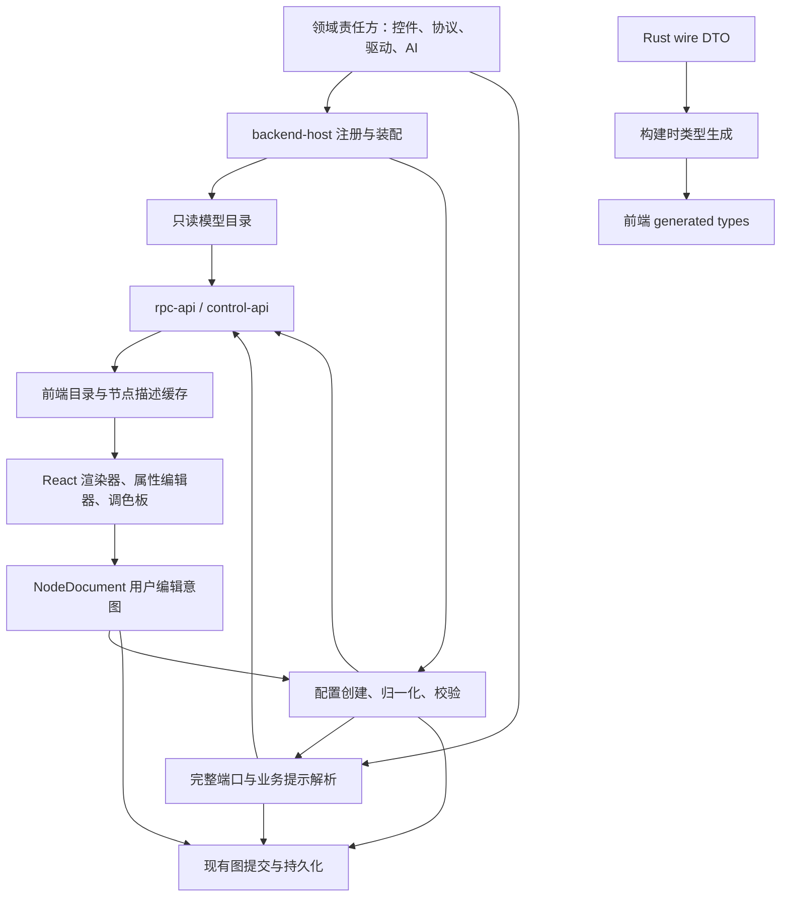

# 前后端共享模型统一实施计划

本文是待实施方案，不表示以下接口或功能已经存在。范围已经确认：全部前后端共享业务模型，包括节点、设备与协议能力、控件配置、默认值、AI provider 配置及数据契约。

目标是让后端定义并注册业务模型，前端获取可用目录、创建结果和端口描述；共享 TypeScript 类型从 Rust 导出；前端保留 React 组件、交互和视觉呈现。实现完成后，新增已有渲染方式支持的业务条目不需要再修改前端业务白名单。

## 执行前提

- 本计划基于当前工作区，而不是仅基于 HEAD。工作区存在大量设备树、数据平面及前端的未提交改动，执行者不得 reset、覆盖或迁回旧实现。
- 已读取 `docs/architecture/crates.md` 并执行 `pnpm architecture`。实际工作区仍有 `kind`、`schema_types`、`hir`、`lower` 等 crate，落点以实际依赖报告为准，不夹带 crate 合并或改名。
- 每次修改 Rust 前重新执行架构检查要求。类型放在真正的责任方，消费者直接依赖定义者；本改造不新增通用 registry/facade crate。
- Desktop 和 Web 的业务出口已经是 HTTP-RPC + WebSocket。新增业务命令进入 `rpc-api`，不要增加 Tauri 业务 command。
- 保留既有 JSON 字段、枚举大小写、handle ID、命令名、事件名和工作区格式。目录版本、配置版本、图版本分别管理。
- 每个工作包完成后运行其针对性验证；在整体检查通过前不要声称整个迁移完成。

## 已确认的现状

| 范围 | 已有后端权威 | 前端重复或缺口 | 实施方向 |
|---|---|---|---|
| 设备与适配器 | `device-tree::DriverRegistry`，`backend-host/src/assembly.rs` 装配 | 已有 capabilities 获取，但 driver manifest、父子限制、默认值和实例端口没有统一消费 | 沿用真实注册表，补描述和上下文校验 |
| 图文档 | `kind/src/document.rs::NodeDocument`，`graph_ops::apply_document` | `src/lib/nodes/document.ts` 手写镜像 | 保留 NodeDocument 同步，生成 TS 类型 |
| 控件 | `kind/src/widget_document.rs` 负责 lowering | `widgetDefaults.ts`、`widgetNormalize.ts`、palette、WidgetPorts 各自维护语义 | 后端注册默认、归一化、变体、完整端口和 lowering |
| 运算 | `kind` 中 MathOp、StrOp 与端口表 | `types/common.ts` 的一元集合、STR_OP_PORTS、计算辅助函数 | 从同一后端定义导出元数据，删除重复语义 |
| 协议 | `schema_types` 定义配置，`schema` 执行协议 | `protocolSchema.ts` 构造预设、默认通道、动态端口 | 后端工厂创建预设、统一推导端口 |
| 图端口 | `graph_ops/src/derived.rs` 输出派生信息 | 当前只有输出端口，Sink 仍回退前端 | 增加草稿描述和完整输入/输出投影 |
| 仿真 | `data-model` 仿真配置及 `device-tree` SimulationDriver | 前端默认、波形枚举、值域和编码格式；后端 schema 很薄 | schema、默认、校验和支持格式由后端提供 |
| AI provider | `llm/src/types.rs::ADAPTERS` 与适配器解析 | `components/settingFields.ts` 另有 provider 选项，默认和校验也在前端 | 将可选项及配置规则纳入目录 |
| RPC / 事件 / 数据 DTO | Rust 定义分布在各责任 crate | `src/types`、`lib/tauri/tauri.ts`、store 内手写镜像 | 按 owner 生成类型并检查契约覆盖 |
| 快速开始与其他创建入口 | 后端接收文档 | 模板、AI、启动种子、拖放、点击分别构造配置 | 共用后端纯工厂，模板只保留场景编排 |

### 必须处理的已有边界

1. `src/store/appStoreHelpers.ts` 已向 `update_tab_graph` 提交 NodeDocument，不要重新改为前端生成 NodeDef。NodeDef 是后端内部编译产物。
2. `graph:derived` 现有 `ports` 只有输出口。仅替换 WidgetPorts 的读取来源无法完成统一，还缺输入口、默认 handle、动态口和草稿状态。
3. `NodeKind::Sink` 对应多种控件，不能仅用 `port_table(Sink)` 得到各控件实际端口；必须保留 NodeDocument 的 widgetKind 和 params 参与解析。
4. `graph_ops/src/document.rs` 仍从静态 adapter endpoint 查设备端口，并维护另一份 widget 默认 handle switch；这些也要收敛。
5. `validate_adapter_configuration` 目前不能作为子驱动完整校验：生产实现使用 `parent=None`，返回原 payload 也不等于已归一化配置。
6. `capabilityCatalog.ts` 缓存是模块级 Promise，重新挂载 React 不会清空它。切换后端、鉴权变化或重连都要隔离请求。
7. `App.tsx` 当前在 workspaceReady 后即可创建 RawData；必须同时等待目录可用，失败不能保存默认空图覆盖原工作区。
8. 当前未知 widget 在组件注册表及属性面板直接索引时可能崩溃，需要显式 Unsupported 展示。
9. `nodeDocument()` 的 `pointSelector` 与 `canvasNode()` / 创建端的 `point-selector` 拼写不一致。修复 ReactFlow 适配并保留 wire 的 `pointSelector`，禁止全局替换三种名称。
10. 当前表单只支持简化 JSON Schema。不能直接接入含 `$ref` / `oneOf` 的任意 schema，也不能把 minimum 或 0 当作业务默认值。

## 目标职责与数据流



运行时目录解决“此后端支持什么、如何创建和配置”；类型生成解决“字段及联合类型是什么”。两者同时实施，生成 TS 不能替代运行时目录，下载 JSON 也不能替代编译期类型。

### 责任归属

| 责任方 | 拟承担内容 | 禁止承担内容 |
|---|---|---|
| `data-model` L0 | 通用可序列化描述合同、schema 容器、诊断字段 | 注册表实例、React、驱动对象、SDK |
| `kind` L1 | 控件参数结构、默认工厂、参数迁移、操作元数据、文档端口和 lowering | HTTP、硬件发现、打开设备 |
| `schema_types` L1 | 协议/解码块/命令块配置与预设工厂 | 网络连接和 UI 组件 |
| 各 signal/vehicle/protocol 类型 owner | 其参数枚举、约束、序列化类型与领域校验 | 复制其他 crate DTO |
| `acquisition` L2 | 设备创建/配置描述所需的无副作用端口 | 依赖 L4 adapter 或引入设备树实现 |
| `device-tree` L2 及各 NodeDriver | 驱动注册、默认配置、父子约束、配置相关能力和端口 | 从前端传入能力位图后直接信任 |
| `app` L3 | 聚合目录合同、文档准备与描述用例、只读注入快照 | 依赖 backend-host/llm 等 L4 |
| `graph_ops` L3 | 将同一归一化及端口解析用于提交、派生和拓扑校验 | 再写一套 kind switch |
| `llm` / `ai-host` L4 | provider 注册及 AI 配置权威校验 | 返回密钥作为目录或默认值 |
| `backend-host` L4 | 根据实际 feature 注册领域能力，注入 app | 第二份业务默认值与模型白名单 |
| `control-api` / `rpc-api` | 薄用例入口、参数解码及序列化 | 自己构造另一套目录 |
| 前端 | React 组件、编辑器、图标、主题、布局、输入草稿、交互 | 业务默认工厂、端口语义、支持种类白名单 |

通用 ConfigurationSchema 目前定义在 `acquisition/src/capabilities.rs`，而 `kind` 是 L1，不能为了 schema 依赖 L2。把这个确实跨域使用的纯数据结构移动到 `data-model` 的新模块，所有 Rust 消费者直接改为引用新 owner；保持原序列化。不要同时保留同名 DTO，也不要通过 acquisition 的公共转发掩盖 owner。

`DriverProjection` 保留现有 owner；通用目录只保存用于创建和展示的模型投影，通过 acquisition 端口取得。需要 driver 专属详情的旧 API 继续返回它，避免把通用目录做成复制所有领域结构的巨型 DTO。

## 需要固定的接口设计

下面名称为建议采用的新 API；实现时先完成契约再迁移调用方。新增字段统一 camelCase，既有结构嵌入时保持原名称。

### 模型目录：`get_model_catalog`

返回 `ModelCatalog`：

| 字段 | 含义 |
|---|---|
| `contractVersion` | 目录合同版本；不支持时进入兼容错误页 |
| `revision` | 根据实际注册的静态描述生成的稳定不透明字符串 |
| `models` | 模型描述列表，按稳定顺序返回 |

每个 `ModelDescriptor` 至少包含：

- `id`：稳定目录 ID，例如 `widget:Math`、`protocol:JustFloat`、`driver:serial`；不改变旧 wire kind。
- `family`：widget、protocol、device、pointSelector、aiProvider。
- `schemaVersion`：配置结构版本；现有 device 的 schemaVersion 原样保留。
- `display`：labelKey、fallbackLabel、descriptionKey、category、排序值；翻译、图标和主题仍在前端。
- `ui`：rendererKey、editorKey，可选图标/展示提示，全部是数据键而不是代码。
- `configuration`：共享 ConfigurationSchema，明确为本项目支持的表单 schema 子集。
- `defaultConfig`：不含实例 ID 的默认预览；只用于提示，实际创建必须调用后端工厂。
- `variants`：如 Math/Str 操作、Filter preset，包含稳定 variant ID 及展示信息；变体参数由后端工厂解释。
- `actions`：支持创建节点、配置编辑或其他适用动作；AI provider 不伪装为图节点。
- `availability`：可用/不可用及原因；已编译但当前环境受限与未注册要区分。

目录来自实际注册对象，不手写第二张全局总表。驱动开闭状态、发现的设备、已配置节点、运行时通道数不放入静态目录；继续使用各自动态 API/事件。首版不增加热加载插件机制，重连重新获取目录即可。

### 文档准备：`prepare_node_documents`

这是纯用例，返回草稿，不修改图、不保存文件、不打开设备。支持批量，以覆盖快速开始模板。

请求包含 `catalogRevision` 与 `operations`。每项使用带 tag 的联合：

- `create`：modelId、可选 variantId、nodeId、tabId、layout、可选 label、configPatch，以及可选设备父上下文。
- `normalize`：已有 NodeDocument，以及可选设备父上下文。

返回与每个请求项对应的 `document`、`description`、`issues`。错误使用结构化 code/path/message/severity；表单未填必填值可返回可编辑草稿及问题，不将其当作运行成功。未知 model、版本不支持、重复 identity 等返回明确错误。

必须固定以下行为：

1. 前端生成 nodeId，后端基于它确定性创建默认 option/frame/rule 等子 ID；重复请求不得产生不同 ID。复制节点使用新 nodeId，按 owner 的克隆规则改写内部引用；撤销重做重用已生成文档。
2. 新建配置合并顺序：后端默认 → 后端 variant → discovery patch → 用户 configPatch。对象按字段合并，数组整体替换，null 是显式值，缺省才保留默认；随后由领域校验。Discovery 和用户 patch 不可修改顶层 node identity。
3. Normalize 使用 owner 的迁移规则，不能将创建默认值全量覆盖用户原值，也不能随机重建 ID。
4. 子设备传 parentNodeId 或同批父草稿引用；后端从当前文档/批次拓扑求出 ParentContract。客户端不得伪造父能力以绕过校验。先拓扑排序，拒绝环和不存在的父项。
5. 返回同一 catalogRevision；若请求版本已失效，返回可重试的目录不匹配问题，前端刷新后重新准备。
6. label 缺省使用后端稳定 fallback；前端可以传本地化名称，但后续切语言不重写用户名称。

### 文档描述：`describe_node_documents`

请求包含 documents、相关 edges/父上下文、catalogRevision 和客户端 requestRevision。仅分析配置与拓扑，不要求整个图成功编译，不执行脚本或 I/O。

每个节点返回 `NodeDescription`：

- nodeId、requestRevision、status（ready / incomplete / unsupported）。
- inputs 和 outputs；每个端口包含稳定 handle、label、数据域、支持的连接域、是否动态及连接数量限制。
- defaultInput / defaultOutput、effectiveChannels（适用时）、结构化 issues。
- 需要 RawData 路由等拓扑语义时返回显式提示，不让前端通过 kind 名字推断。

内部仍使用现有领域端口类型；wire 投影集中完成。数据域转换须穷尽处理并测试，不能用默认 F32 隐藏未知类型。不要在当前工作中顺手修改历史 handle 拼写。

Math/Str、协议自动通道、Command var_ref、FrameDecoder blocks、Model3D、PointSelector、Custom 端口和 RawData `src:` 路由都要覆盖。Custom JS 仍由现有前端执行环境解析用户端口声明；后端校验声明的 ID、重复和域，不执行该 JS。

首版允许 describe 以批量提交当前 tab 草稿和 edges，避免为动态端口另建前端规则解释器。一次请求内某节点参数不完整，不应阻断其他节点描述。能确定的端口照常返回，不能确定的用 incomplete 表达，不能冒充权威空表。

### 与图提交及事件的关系

- `update_tab_graph` 继续接收 NodeDocument，并再次使用同一 normalize/validate/describe；不能因为前端做过 prepare 就跳过后端校验。
- 图编译、拓扑默认 handle、前端渲染都读取同一解析结果，设备端口读取配置及父上下文对应的 projection。
- 现有 `GraphDerived.ports` 保持输出语义，添加可选完整描述字段以兼容旧客户端；不要把 ports 偷改为输入输出混合表。
- 提交结果和 `graph:derived` 的完整描述携带已提交图版本，前端与草稿 requestRevision 分开管理。
- 旧 `list_adapter_capabilities`、`list_driver_manifests`、相关校验命令保留兼容，内部委托同一权威定义。新接口加入 SUPPORTED，不能落入 DESKTOP_ONLY。

## 构建时类型生成

采用 Rust 为源的 `ts-rs` 导出管线。它是本计划建议新增的唯一基础代码生成依赖，用于删除手写 wire 镜像；实施时在根 workspace.dependencies 统一登记并核对当前 Rust/MSRV 与许可证。官方文档支持 serde 兼容和显式导出，同时说明未支持的 serde 属性会告警，因此生成结果必须用真实 JSON fixture 验证，不能假定 derive 自动保证所有 wire 语义。参考：[ts-rs 官方文档](https://docs.rs/ts-rs/latest/ts_rs/)。

- 导出入口建议为 `rpc-api/examples/export_contracts.rs`，仅引用各 owner 类型，不启动 BackendHost，不访问硬件、用户配置或网络。
- 增加 `pnpm generate:contracts` 和 `pnpm check:contracts`。后者输出到临时目录比较，不能偷偷修改工作区。
- 产物进入 `src/types/generated/`；前端原类型文件可以临时显式 re-export 保持 import 路径兼容，但禁止保留第二份定义。
- 公共 wire 类型在其 owner 派生导出能力。生成器需要的依赖直接引用 owner；`rpc-api` 是 L4，不能让低层 crate 反向依赖生成器。
- 使用显式导出程序，不使用测试运行时自动写 bindings 的模式；生成结果路径、换行和排序必须确定。
- 对 `serde_json::Value` 输出 JSON 值类型或 unknown，不使用 any 掩盖业务类型；已知 widget 配置必须是生成的判别联合。
- 检查 tag/content/flatten/rename/skip/default、自定义序列化、透明 newtype、递归联合、空值与可选字段。
- i64/u64 的 TS 表示服从现有真实 wire。现有点值字符串保持字符串；现有数字暂不擅改为 bigint，单独记录精度边界并做边界 fixture。
- API 请求允许省略的字段与响应序列化字段可能不同；确有差异时定义语义明确的请求/响应类型，不为了工具方便改变 serde 输出。
- 命令参数目前部分从动态 JSON 解码：逐个提取 Rust 参数结构并复用到 dispatch 及类型导出；命令名来自现有 rpc-api catalog。生成 CommandMap/EventMap 时不另写未经覆盖检查的字符串清单。
- 类型生成不提供运行时校验。目录 envelope 在前端进行版本和结构检查；业务数据最终由 Rust 校验。

覆盖清单必须包括：NodeDocument/Edge/GraphDerived/graph:source、设备/能力/点值与读写、协议/解码/命令块、控件配置、CAN/逻辑分析、波形/频谱/测量、运行状态、录制和工作区、AI/MCP/结构化错误，以及所有前端实际调用的 RPC 请求/响应与事件 payload。二进制波形/显示流保留现有帧协议及解码实现，增加跨语言 golden fixture；不能用 JSON 类型生成替代二进制合同测试。

## 实施工作包

以下每个工作包都应单独形成可审阅的小变更。新路径明确标记为“新增”；现有大文件超出 500 行时拆职责模块，不增加新的超长 Rust 生产文件。

### 基线与合同清单

输入：当前工作区，`docs/architecture/crates.md`，架构报告。

执行：

1. 记录 `git status --short`，不提交或处理无关改动。运行现有检查并记录原有失败。
2. 新增 `docs/architecture/shared-model-inventory.md`，逐项登记：前端符号、Rust owner、wire 名称、调用方、默认/校验/端口来源、迁移去向。
3. 扫描 `src/types`、`src/lib/tauri`、store 内 payload、RPC catalog 和事件发射点；特别登记当前用 Value/匿名 JSON 的边界。
4. 收集代表性的旧 workspace、所有 widget 默认配置、协议预设和 RPC JSON 为测试 fixture，不包含用户本机真实工作区或密钥。
5. 为设备、协议、点位选择器、控件写 NodeDocument ↔ ReactFlow round-trip 测试，并修复 point-selector 适配拼写。

验收：每个共享模型有明确 owner；前端纯 UI 类型单列；当前已有功能及失败基线可追溯。

### 共享描述合同与类型导出基础

依赖：基线与合同清单。

涉及：`data-model/src/model_descriptor.rs`（新增）、`acquisition/src/capabilities.rs`、各消费者 import、`rpc-api/examples/export_contracts.rs`（新增）、`scripts/generate-contracts.mjs`（新增）、package.json、Cargo manifests、`src/types/generated/`。

执行：

1. 移动 ConfigurationSchema 到真正的共享 owner，保持 JSON 原样；不要添加跨层依赖。
2. 定义 ModelDescriptor、ModelCatalog 及准备/描述所需公共合同；包含 NodeDocument 的请求/响应由 app 定义，避免 L0 依赖 kind。
3. 先导出目录合同、NodeDocument、现有协议/设备类型，迁移对应 TS imports；其他 DTO 随各工作包继续补齐。
4. 加生成检查、serde golden fixtures 和 strict typecheck；保留不兼容属性告警。

验收：两次生成无差异；修改 Rust 字段后 check:contracts 能检测漂移；既有 JSON fixtures 不变；架构与依赖检查通过。

### 控件与操作定义注册

依赖：共享描述合同与类型导出基础。

涉及：`kind/src/widget_document.rs`、`kind/src/ports.rs`、`math_op.rs`、`str_op`；新增 `kind/src/widgets/`，按 controls、displays、math、text、command、decoder、custom 等职责拆模块。

执行：

1. 在 kind 内建立定义列表，每项绑定 descriptor、默认工厂、normalize/validate、ports 和 lower。按稳定 widgetKind 查找，重复 ID 启动时失败。
2. 将当前 29 类控件的共享参数建模为 Rust 类型并导出 TS。保留 NodeBusiness::Widget 的现有字符串 kind + JSON params 外形，内部按已注册 kind 解码。
3. 从 `src/lib/utils/widgetDefaults.ts` 迁移实际默认语义，包括 Radio/Checkbox options、Command frame、Trigger rule、Custom 默认样例。样例文本可放后端静态资源，不能让后端执行它。
4. 迁移 `widgetNormalize.ts` 及 `commandFrames.ts` 中负责旧配置迁移的逻辑，明确创建默认与历史迁移是不同函数。
5. Math/Str 元数据与 Rust 运算定义同源；一元性、输入数量、Str 数字内联字段、输出域用于描述和校验。
6. 收敛 `widget_document::lower` 和图中默认 handle switch；实际 lower 委托注册定义。
7. 对显示控件按其文档配置解析端口；不能把所有 Sink 的 spectrum/loopbackOut 都展示给每个控件。

验收：全部现有 widget 注册且默认可归一化；normalize 幂等；已知配置 lowering 不变；每个默认及变体的输入输出端口有测试；未知 kind 明确 unsupported。

### 协议、设备、仿真与 AI 注册补全

依赖：共享描述合同与类型导出基础。可与控件注册并行，但不要同时编辑共享合同。

涉及：`schema_types/src`、`device-tree/src/registry.rs` / driver / simulation、各 adapter descriptor、`acquisition/src/plane.rs`、`llm/src/types.rs`、`ai-host`、`backend-host/src/assembly.rs`。

执行：

1. 将 `src/lib/utils/protocolSchema.ts` 中预设工厂迁入 schema_types；保留 JustFloat/FireWater 自动通道、RawData 字符串、CAN/LogicDecode 行为及旧 preset 名称。
2. 由协议和命令/解码块定义提供支持枚举、默认和字段规则；列表不能再次写在属性编辑器中。
3. 给 NodeDriver 的静态描述补充默认配置及创建提示，投影 child_policy；完整实例端口使用 runtime_capabilities / port_descriptors 和父上下文。
4. 扩展 acquisition 的纯描述/归一化端口，由 device-tree 实现；禁止 app 为了调用 L4 driver 而破坏依赖层级。
5. 补齐 SimulationDriver schema、默认、波形/编码选项，复用 data-model 仿真参数与现有校验。
6. 合并 LLM provider 目录与 adapter_kind_from_str 的注册来源；检查 `openai_responses` 等当前解析支持但目录未列出的兼容项，保留旧配置解析能力。
7. 输出 provider 的默认 URL、是否需要自定义 URL/密钥等声明；前端 provider 名单及默认从目录读。模型名称保留自由输入，当前任务不新增远端模型发现服务。
8. 目录只包含当前 feature 实际注册的适配器；为 default、无默认 feature、Modbus/S7 组合补测试。硬件发现失败不应使整个模型目录失败。

验收：协议预设 JSON 与旧行为一致；子驱动校验收到真实父合同；仿真不靠前端补默认；provider 名单/解析一致；关闭 feature 后目录不出现可创建假条目。

### 文档用例与统一 RPC

依赖：控件注册、其他领域注册补全。

涉及：`app/src/models/`（新增）、`graph_ops/src/document.rs` / `derived.rs`、`backend-host/src/host.rs` / assembly、`control-api/src/toolbox.rs` / tools、`rpc-api/src/models.rs`（新增）/ lib / catalog。

执行：

1. backend-host 从各领域生成目录并注入 app 的不可变快照；Toolbox 引用相同服务，不复制目录。
2. 实现 prepare_node_documents 与 describe_node_documents；app 编排 kind/schema_types/acquisition，所有领域逻辑仍在各 owner。
3. describe 不依赖成功编译、不打开设备、不修改工作区。支持批次父子关系、同图拓扑和局部错误。
4. 图提交使用同一归一化和完整端口解析；由描述生成 SourceNodeHint，删掉独立 default handle switch。
5. 保持旧命令及派生字段，新增完整描述字段与版本；catalog SUPPORTED 和 dispatch 一起更新。
6. CLI `rpc` 直通覆盖新命令。MCP 与现有 AI 工具通过 control-api 暴露同一只读目录及文档准备能力，随后仍走既有写图入口；不复制默认工厂。
7. 新 RPC 请求/响应加入类型导出；为命令参数、错误 code、序列化和无副作用写集成测试。

验收：Desktop/Web/CLI 得到同一目录；MCP/AI 的文档准备与 UI 一致；准备失败不会保存图或开设备；编译失败仍可得到节点草稿描述；旧命令兼容测试通过。

### 前端目录生命周期与共享创建入口

依赖：统一 RPC。

涉及：`src/store/modelCatalogStore.ts`（新增）、`src/lib/models/`（新增）、`src/lib/rpc/index.ts`、`BackendConnectionGate.tsx`、`App.tsx`、`capabilityCatalog.ts`、`appStoreHelpers.ts`、`slices/events.ts`。

执行：

1. Store 管理 idle/loading/ready/error/incompatible、revision、byId、当前连接 generation；进行 envelope 校验、并发请求去重和失败重试。
2. configureBackend/disconnectBackend 每次变更递增 generation 并使目录、节点描述和旧请求失效。不得用 bearer token 作为日志/缓存键；认证变化通过 generation 隔离。
3. 所有响应检查发起时 generation；旧后端迟到响应不得写入新 store。同一 backend URL 重启后也重新加载。
4. 建立启动屏障：连接可用 → 目录 ready → 工作区恢复并描述 → 放行创建和图同步。可显示 loading 页面，不能在恢复失败时补写空工作区。
5. 将模块级 capability Promise 纳入同一连接生命周期；如果保留旧 API wrapper，不能继续永久缓存旧连接数据。
6. 实现唯一 `createNodeFromCatalog` 和批量 prepare 封装，负责 pending、错误展示、ID 与布局传递，成功后才写入本地编辑状态。
7. 新增与重连后的 RawData 种子只在后端确认“首次空工作区”且屏障完成时创建，双 effect 或重试不重复创建。

验收：首次启动、失败重试、断线重连、切换服务、认证变化、旧请求迟到都有测试；目录失败不写 workspace；重复请求不产生重复节点。

### 前端 UI、所有创建入口及端口消费迁移

依赖：目录生命周期与共享创建入口。

涉及：widgetPalette、NodeEditor、widgets/nodes registry、WidgetPorts、WidgetProperties、connectionRules、types/common、各属性编辑器及以下创建调用方。

必须逐个迁移的入口：

| 入口 | 当前文件 | 目标 |
|---|---|---|
| 启动 RawData | `src/App.tsx` | prepare 后插入一次 |
| 新建控制页 | `src/store/slices/controlTabs.ts` | 共用创建服务 |
| 添加/更新/Custom | `src/store/slices/widgets.ts` | prepare/normalize，保留用户草稿 |
| 面板点击 | `src/components/panels/widgetPalette/CategoryPanel.tsx` | modelId + variantId |
| 面板拖放 | `src/components/layout/NodeEditor.tsx` | 与点击共用同一 helper |
| 结构节点 | `src/lib/utils/paletteCreation.ts` | 后端创建设备/协议/PointSelector |
| AI 创建 | `src/lib/ai/toolHost.ts` | 后端文档准备及既有写图入口 |
| 快速开始 | `src/lib/quickstart/templates.ts` / applyTemplate | 模板只声明 modelId、显式场景参数及连线布局，批量 prepare |
| 测试工厂 | `src/test/nodeDocuments.ts` | 后端导出的 fixtures，禁止恢复一套 TS 默认工厂 |

执行：

1. Palette 从目录生成条目和变体，删除 widget/Math/Str/Filter 支持项白名单；类别颜色和图标映射保留前端。
2. `WIDGET_REGISTRY` 改为 UI registry，只含 renderer/editor/icon 等本地实现。新增业务条目使用已有 rendererKey 即可工作；新视觉组件仍需要前端实现，这一边界要在文档写清。
3. 用生成的 WidgetParams 联合保证已知编辑器类型安全；开放目录 ID 与未知配置使用显式 Unknown 类型，不能把整个系统改成 any。
4. 把节点注册表中的 ports 回调改为读取 NodeDescription；WidgetPorts 移除业务 switch，保留必要的 UI 排版。
5. 属性草稿变化时批量/防抖 describe；使用 requestRevision 丢弃旧响应。描述仍 pending 时保留上一份可见端口并显示状态，不立即删除边。
6. 区分 absent、pending、ready-empty、incomplete、unsupported。只有权威确认端口已移除，才按现有用户意图处理悬空边；不能拿空数组触发本地默认回退。
7. 连接校验读取描述中的数据域与限制；最终提交仍由后端校验。参数改变造成旧边无效时显示诊断，不静默丢失用户连线。
8. Unknown model/renderer/editor 使用 UnsupportedNode 或受限通用表单，保留原始文档，支持查看、导出、删除；不能降级成 Sink 或换成另一种默认配置。
9. 设备表单、SimulationProperties、ProtocolProperties、AI settings 的选项和规则来自目录。通用表单只接受已声明 schema 子集；不支持的形式给出明确提示，不能假装校验成功。
10. `widgetToNodeKind` 的 Custom 使用改为独立 `customWidgetPortDeclaration`。清除旧 lowering 前先检索消费者，移出仍使用的 rawDataPortId、GraphEdge 等适配工具。

验收：点击/拖放/AI/模板/种子生成同等配置；不改前端 palette 即可显示新增后端变体；全部输入输出 handle 与描述一致；未知组件不崩溃；pending 不删边。

### 持久化、完整契约覆盖与重复定义清理

依赖：领域注册和用例；删除前端代码必须等对应调用方全部迁移。

涉及：`app/src/workspace.rs`、`backend-host/src/lifecycle.rs`、`graph_ops`、workspace hydrate、`src/types`、`lib/tauri`、`widgetNormalize.ts`、`protocolSchema.ts`、`types/common.ts`、CI。

执行：

1. 工作区恢复、导入、图提交、MCP/AI 修改一律进入同一后端迁移/校验。已有 source docs 是持久化事实，NodeDescription、目录副本及 React 节点不落盘。
2. widget 配置缺少版本时按已知历史形态迁移；本次不强制改变 NodeDocument wire 外形。若确需新版本字段，单独加可选字段及旧读写兼容 fixture，不与 catalog contractVersion 混用。
3. 严格区分“文件不存在”与“未知模型/不兼容/解析失败”。当前 load_workspace 存在失败按不存在处理的路径，不能让新模型加载失败导致后续空白保存覆盖文件。
4. 对未知 widgetKind/driver 保留完整原始参数和边，标记 unavailable；不自动执行、替换或丢弃。保留已知 document family 的未知模型是首要范围；更高版本整个文件无法读取时保留文件并报告不兼容。
5. 迁移后的配置写入遵循现有持久化事务；迁移或校验失败保持原文件。增加真实文件往返和失败不覆盖测试。
6. 补齐合同清单剩余所有 RPC/事件/DTO 导出，迁移调用泛型、store payload 和 src/types 镜像；UI 本地类型明确分离。
7. 根据实际引用删除前端业务默认、归一化、STR_OP_PORTS、一元集合、协议预设工厂和旧 NodeKind lowering。computeMathResult 先查生产调用，死代码删除；如仍承担业务求值则改读后端结果，不能悄悄留另一套求值器。
8. 清理前端业务型 settings 默认，保留主题、布局、窗口等本地偏好；共享业务配置按目录/后端设置用例获取，不迁移视觉交互状态。
9. 加 `check:model-catalog`：验证注册 ID/变体唯一、rendererKey 合同、所有已知 widget 覆盖、schema 默认与实例工厂可验证、定义与 lowering 对应；附导出 fixture 检查。
10. CI 接入 check:contracts、check:model-catalog 和既有 web-contract；更新架构文档和本计划对应完成记录，代码注释只描述最终职责。

验收：旧工作区无损恢复；未知模型不被覆盖；所有合同清单条目已生成或明确为纯 UI/二进制协议；生产前端不存在第二套业务定义表。

## 执行依赖与拆分建议

| 工作包 | 前置 | 可并行范围 |
|---|---|---|
| 基线与合同清单 | 无 | 前端与后端只读盘点 |
| 共享描述合同与导出 | 基线 | 合同冻结后可分别迁移 TS import |
| 控件注册 | 共享合同 | 与协议/设备/AI 注册并行 |
| 协议/设备/仿真/AI 注册 | 共享合同 | 按 owner 分拆，避免多人改 assembly |
| 文档用例与 RPC | 各领域定义可用 | 测试 fixture 可先准备 |
| 前端目录生命周期 | RPC 合同冻结 | 可先用真实后端 fixture 开发 |
| UI 与创建入口迁移 | 目录生命周期、文档用例 | 按调用方拆分，统一 helper 由一人维护 |
| 持久化与全面清理 | 对应后端 owner、前端迁移 | 持久化可提前做；删除必须最后做 |

建议按此表顺序交给能力较弱的模型，每次只分派一个工作包。共享文件（Cargo.toml、package.json、types/index、rpc catalog、AppState、Toolbox、assembly）安排一个执行者集中合并，避免并行互相覆盖。

## 验证矩阵

| 场景 | 必须证明的结果 |
|---|---|
| 注册完整性 | 当前 29 widget、结构节点、协议、变体、AI provider 全覆盖，重复注册失败 |
| 新增后端变体 | 前端不改业务白名单即可显示并创建 |
| 创建一致性 | 点击、拖放、模板、AI、MCP、启动种子采用同一默认和归一化规则 |
| 默认值 | 默认实例经过领域校验；创建与 normalize 区分；子 ID 稳定 |
| 完整端口 | Math 一元/多元、全部 Str、FFT/IFFT、Command、多帧变量、FrameDecoder、Custom、Model3D、PointSelector、RawData 正确 |
| 草稿错误 | 无效字段不导致其他节点消失；整图编译失败仍可编辑连接 |
| 异步竞态 | 旧 preview 和旧连接响应不能覆盖新状态；权威空表不走默认回退 |
| 设备树 | 父约束、子数量、CAN/ISO-TP/诊断链及点位能力按实际父配置验证 |
| feature 差异 | 注册列表与可执行能力一致；禁用 Modbus/S7 时不出现可创建假条目 |
| 启动及重连 | catalog 失败不创建空图；重试不重复节点；后端切换不复用旧描述 |
| 未知模型 | 缺 renderer/未知 kind/driver 不崩溃、不替换、不丢参数和边 |
| 历史工作区 | Button/Radio/Checkbox/Gauge/Command/Model3D 及旧协议 fixture 无损迁移；迁移幂等 |
| 文件保护 | 解析、版本或未知模型错误不会走首次启动覆盖原文件 |
| JSON 合同 | serde 名称、null/省略、枚举、数值字符串表示及请求响应保持一致 |
| 二进制合同 | 波形与显示流 golden bytes 在 Rust/TS 两端解码一致 |
| 出口一致性 | HTTP、Desktop sidecar、CLI rpc、MCP 共用核心定义；无新增 Tauri 业务 command |

优先扩展现有测试：widgets registry、widgetPorts、connectionRules、capabilityCatalog、schemaForm、workspaceHydrate、initialGraph、adoptSourceGraph、syncTabGraph、quickstart、settingsStore，以及 Rust kind/device-tree/graph_ops/rpc-api/workspace persistence 测试。

完成前运行以下整体检查。新增命令须在前面的工作包实现后才可使用：

```sh
pnpm check:architecture
pnpm check:deps
pnpm check:web-contract
pnpm check:contracts
pnpm check:model-catalog
pnpm typecheck
pnpm test
pnpm build
cargo fmt --manifest-path src-tauri/Cargo.toml --check
cargo clippy --manifest-path src-tauri/Cargo.toml --workspace --all-targets
cargo test --manifest-path src-tauri/Cargo.toml --workspace
```

另在 `src-tauri` 目录执行 `cargo deny check`，并按受影响 feature 组合运行相应编译/测试。实际启动 `pnpm dev:desktop` 与 Web + backend-server，验证创建、编辑、连线、保存恢复、重连、未知模型和 AI 设置。现有大量前端单测仍走 test-only Tauri mock，必须补真实 HTTP-RPC 集成测试，不能把旧 mock 通过当作网络路径已验证。

## 给执行模型的直接指令模板

> 阅读本计划及 AGENTS.md，只实现指定工作包。先报告它的输入、前置验收是否已满足及当前工作区相关改动；然后按指定 owner 和接口实施，不重新设计全局架构。Rust 修改前读取架构文档并运行 pnpm architecture。保留既有 wire、持久化和 handle ID；不把共享类型降级为 any，不添加前端业务 fallback，不把描述接口接到设备打开或图保存。完成后列出修改文件、运行的测试及结果、未解决问题和下一个可执行工作包。未跑过的检查明确说明。若前置不成立，指出具体符号/错误及最小补齐方案，不能用 TODO 或假实现宣称本包完成。

## 最终完成标准

- 后端注册决定前端可用业务模型；前端有唯一目录获取和创建服务。
- 默认、迁移、校验、完整端口和 lowering 由各后端责任方提供并复用。
- 全部创建入口和工作区恢复采用相同规则，无遗漏入口继续使用旧工厂。
- wire 类型由 Rust 生成，生成和覆盖检查能阻止新的手写镜像漂移。
- 前端仅保留展示、交互和显式用户配置草稿，未知模型及连接失败不会造成数据丢失。
- Desktop、Web、CLI、MCP 与 AI 路径一致，旧工作区及现有协议保持兼容。
- 验证矩阵及整体检查实际执行通过，所有限制和未验证项明确记录。
