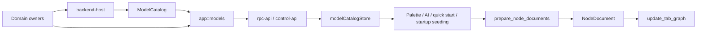

# Shared Model Catalog Implementation

<!-- lissio-doc
status: maintained
owner: Lissio maintainers
last-reviewed: 2026-10-07
applies-to: Current model catalog, node creation, and description workflow
-->

This document describes the current shared model catalog and node creation
contracts. Design constraints are in
[`backend-model-catalog-plan.md`](backend-model-catalog-plan.md); wire ownership
is listed in [`shared-model-inventory.md`](shared-model-inventory.md).

## Structure

1. Domain owners such as `kind`, `schema_types`, `device-tree`, and `llm` define
   parameters, defaults, constraints, ports, and lowering semantics.
2. `app::models` assembles the catalog and implements
   `prepare_node_documents` and `describe_node_documents`.
3. `control-api` and `rpc-api` expose one RPC surface. The frontend
   `modelCatalogStore` owns catalog lifecycle, and every creation entry point
   uses `createFromCatalog`.



## Backend ownership

- `data-model::model_descriptor` owns generic wire contracts for configuration
  schemas, catalogs, descriptors, ports, and model issues.
- `kind::widgets` is the source of defaults, normalization, variants, ports, and
  lowering for widget models.
- `schema_types::preset` derives protocol preset ports and channels.
- `NodeDriver::display_name()` and `default_config()` provide device display and
  configuration defaults.
- `app::models::{catalog, prepare, describe}` owns snapshots and draft creation.
- `backend-host` assembles only enabled drivers and AI providers.

| RPC command | Behavior |
| --- | --- |
| `get_model_catalog` | Returns a read-only catalog with contract version and revision |
| `prepare_node_documents` | Creates normalized documents from model, variant, and config patch without persistence |
| `describe_node_documents` | Resolves draft ports, default handles, dynamic ports, and structured issues |

Request payloads are whole DTOs with stable top-level camelCase fields.

## Frontend lifecycle

- `modelCatalogStore` tracks revision, model indexes, load and compatibility
  state, and connection generation.
- Backend connection, authentication, or URL changes advance the generation so
  late responses cannot overwrite a new connection.
- `BackendConnectionGate` prevents the application from restoring a workspace
  before the catalog is ready.
- `createFromCatalog` is shared by palette, drag/drop, AI, quick-start, startup
  seeding, and tests.
- `describeStore` batches draft descriptions and resolves ports and issues.
- `WIDGET_REGISTRY` owns renderers, editors, and icons only; unknown models use
  `UnsupportedNode` and restricted settings.

## Type contract

Rust wire owners derive `ts_rs::TS`; `rpc-api/examples/export_contracts.rs`
exports them. `pnpm generate:contracts` writes `src/types/generated/`, and
`pnpm check:contracts` compares a temporary output byte for byte.

Generated types define shape, not validation. Rust parses and validates business
configuration. Open JSON values remain limited to open payloads and UI hints.

## Current boundaries

- Adapter validation is not a substitute for typed parent-port closure checks.
- Forms support the project JSON Schema subset, not arbitrary `$ref` or `oneOf`.
- Numeric constraints such as `minimum: 0` do not create business defaults.
- UI-only constants, themes, layout, icons, i18n, and interaction stay in the
  frontend.

## Verification

```bash
pnpm check:contracts
pnpm check:model-catalog
pnpm check:web-contract
pnpm typecheck
pnpm lint:ci
pnpm test
```

New models, variants, wire fields, or creation semantics require synchronized
owners, generated contracts, fixtures, and tests.
