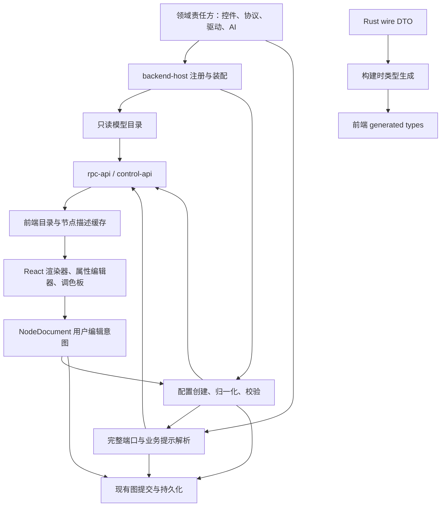

# 共享模型目录与合同架构

<!-- lissio-doc
status: maintained
owner: Lissio maintainers
last-reviewed: 2026-10-07
language: zh-CN
authoritative: false
translation-of: docs/architecture/backend-model-catalog-plan.md
applies-to: Non-authoritative Chinese translation backup
-->

> 中文翻译备份；对应的英文源文件为权威版本。若中英文不一致，以英文为准。
> Chinese translation backup. The English source is authoritative; English controls in case of conflict.

本文定义已经落地的前后端共享业务模型结构：节点、设备与协议能力、控件配置、默认值、AI provider 配置及数据契约均由后端责任方定义并注册；前端获取目录、创建结果和端口描述，共享 TypeScript 类型从 Rust 导出。前端只保留 React 组件、交互和视觉呈现，不维护业务支持种类白名单。

## 结构约束

- 类型放在真正的责任方，消费者直接依赖定义者；不新增通用 registry/facade crate。
- crate 边界以 `docs/architecture/crates.md` 与 `pnpm architecture` 为准。
- Desktop 和 Web 的业务出口已经是 HTTP-RPC + WebSocket。新增业务命令进入 `rpc-api`，不要增加 Tauri 业务 command。
- 保留既有 JSON 字段、枚举大小写、handle ID、命令名、事件名和工作区格式。目录版本、配置版本、图版本分别管理。
- 任何契约变更都同时更新 Rust owner、生成 TS、调用方与 golden fixtures。

## 责任边界

| 范围 | 后端权威 | 前端保留 | 结构边界 |
|---|---|---|---|
| 设备与适配器 | `device-tree::DriverRegistry` 与各 `NodeDriver`，由 `backend-host` 装配 | 设备树交互与表单呈现 | manifest、默认配置、父子约束和实例端口由注册表投影 |
| 图文档 | `kind::document::NodeDocument` 与 `graph_ops::apply_document` | React Flow 适配和编辑意图 | wire 类型由 Rust 导出，`NodeDef` 只存在于后端编译内部 |
| 控件 | `kind::widgets` 的默认、归一化、变体、端口与 lowering | renderer/editor/icon 注册 | `WIDGET_REGISTRY` 是纯 UI 注册表，不定义业务语义 |
| 运算 | `kind` 中 MathOp、StrOp、端口和 lowering | 操作编辑交互 | 一元性、输入数量和输出域从后端描述读取 |
| 协议 | `schema_types` 的配置、预设工厂和端口推导 | 协议表单交互 | 前端不构造协议预设或业务默认通道 |
| 图端口 | `app::models::describe` 与 `graph_ops` | 连线交互和端口显示 | 输入、输出、默认 handle、动态口与草稿状态统一由 describe 投影 |
| 仿真 | `data-model` 仿真类型与 `device-tree::SimulationDriver` | 仿真表单交互 | schema、默认、值域和编码格式由后端提供 |
| AI provider | `llm::types` 与 `app::models::build_model_catalog` | provider 设置表单 | provider 选项、URL/密钥规则来自目录；密钥不进入目录 |
| RPC / 事件 / 数据 DTO | 各 Rust owner 与 `rpc-api` | 消费生成类型 | `src/types/generated/` 是 wire 类型唯一定义产物 |
| 创建入口 | `prepare_node_documents` 与 `createFromCatalog` | 场景编排与草稿 | 启动种子、面板、AI、模板和测试共用同一创建服务 |

### 必须保持的边界

1. `update_tab_graph` 接收 `NodeDocument`；前端不生成后端 `NodeDef`。
2. `GraphDerived.ports` 保持输出语义，完整输入/输出描述由独立字段承载。
3. `NodeKind::Sink` 的端口必须结合 `widgetKind` 与 `params` 解析。
4. 目录、能力目录与节点描述按连接 generation 隔离；迟到响应不得写入新连接。
5. 目录未 ready 前不挂载业务 App，不恢复工作区，也不保存默认空图。
6. 未知模型或 widget 显式进入 unsupported 展示，不索引缺失注册项。
7. ReactFlow 的 `point-selector` 只存在于适配层；wire 拼写保持 `pointSelector`。
8. 表单只消费项目支持的 JSON Schema 子集；`minimum` 或 `0` 不自动成为业务默认值。

## 职责与数据流



运行时目录解决“此后端支持什么、如何创建和配置”；类型生成解决“字段及联合类型是什么”。两者同时实施，生成 TS 不能替代运行时目录，下载 JSON 也不能替代编译期类型。

### 责任归属

| 责任方 | 承担内容 | 禁止承担内容 |
|---|---|---|
| `data-model` L0 | 通用可序列化描述合同、schema 容器、诊断字段 | 注册表实例、React、驱动对象、SDK |
| `kind` L1 | 控件参数结构、默认工厂、参数迁移、操作元数据、文档端口和 lowering | HTTP、硬件发现、打开设备 |
| `schema_types` L1 | 协议/解码块/命令块配置与预设工厂 | 网络连接和 UI 组件 |
| 各 signal/vehicle/protocol 类型 owner | 其参数枚举、约束、序列化类型与领域校验 | 复制其他 crate DTO |
| `acquisition` L2 | 设备创建/配置描述所需的无副作用端口 | 依赖 L4 adapter 或引入设备树实现 |
| `device-tree` L2 及各 NodeDriver | 驱动注册、默认配置、父子约束、配置相关能力和端口 | 从前端传入能力位图后直接信任 |
| `app` L3 | 聚合目录合同、文档准备与描述用例、只读注入快照 | 依赖 backend-host/llm 等 L4 |
| `graph_ops` L3 | 将同一归一化及端口解析用于提交、派生和拓扑校验 | 再写一套 kind switch |
| `llm` / `ai-host` L4 | provider 注册及 AI 配置权威校验 | 返回密钥作为目录或默认值 |
| `backend-host` L4 | 根据实际 feature 注册领域能力，注入 app | 第二份业务默认值与模型白名单 |
| `control-api` / `rpc-api` | 薄用例入口、参数解码及序列化 | 自己构造另一套目录 |
| 前端 | React 组件、编辑器、图标、主题、布局、输入草稿、交互 | 业务默认工厂、端口语义、支持种类白名单 |

通用 `ConfigurationSchema` 由 L0 `data-model::model_descriptor` 定义，所有 Rust 消费者直接引用该 owner；`acquisition` 不再转发同名 DTO。

`DriverProjection` 保留其责任方；通用目录只保存创建和展示所需的模型投影。驱动专属详情由专用命令返回，避免把通用目录变成复制所有领域结构的巨型 DTO。

## 稳定接口

以下 API 是当前稳定契约。新增字段统一 camelCase；嵌入既有 wire 结构时保持其字段拼写。

### 模型目录：`get_model_catalog`

返回 `ModelCatalog`：

| 字段 | 含义 |
|---|---|
| `contractVersion` | 目录合同版本；不支持时进入兼容错误页 |
| `revision` | 根据实际注册的静态描述生成的稳定不透明字符串 |
| `models` | 模型描述列表，按稳定顺序返回 |

每个 `ModelDescriptor` 至少包含：

- `id`：稳定目录 ID，例如 `widget:Math`、`protocol:JustFloat`、`driver:serial`；不改变旧 wire kind。
- `family`：widget、protocol、device、pointSelector、aiProvider。
- `schemaVersion`：配置结构版本；现有 device 的 schemaVersion 原样保留。
- `display`：labelKey、fallbackLabel、descriptionKey、category、排序值；翻译、图标和主题仍在前端。
- `ui`：rendererKey、editorKey，可选图标/展示提示，全部是数据键而不是代码。
- `configuration`：共享 ConfigurationSchema，明确为本项目支持的表单 schema 子集。
- `defaultConfig`：不含实例 ID 的默认预览；只用于提示，实际创建必须调用后端工厂。
- `variants`：如 Math/Str 操作、Filter preset，包含稳定 variant ID 及展示信息；变体参数由后端工厂解释。
- `actions`：支持创建节点、配置编辑或其他适用动作；AI provider 不伪装为图节点。
- `availability`：可用/不可用及原因；已编译但当前环境受限与未注册要区分。

目录来自实际注册对象，不手写第二张全局总表。驱动开闭状态、发现的设备、已配置节点、运行时通道数不放入静态目录；继续使用各自动态 API/事件。首版不增加热加载插件机制，重连重新获取目录即可。

### 文档准备：`prepare_node_documents`

这是纯用例，返回草稿，不修改图、不保存文件、不打开设备。支持批量，以覆盖快速开始模板。

请求包含 `catalogRevision` 与 `operations`。每项使用带 tag 的联合：

- `create`：modelId、可选 variantId、nodeId、tabId、layout、可选 label、configPatch，以及可选设备父上下文。
- `normalize`：已有 NodeDocument，以及可选设备父上下文。

返回与每个请求项对应的 `document`、`description`、`issues`。错误使用结构化 code/path/message/severity；表单未填必填值可返回可编辑草稿及问题，不将其当作运行成功。未知 model、版本不支持、重复 identity 等返回明确错误。

必须固定以下行为：

1. 前端生成 nodeId，后端基于它确定性创建默认 option/frame/rule 等子 ID；重复请求不得产生不同 ID。复制节点使用新 nodeId，按 owner 的克隆规则改写内部引用；撤销重做重用已生成文档。
2. 新建配置合并顺序：后端默认 → 后端 variant → discovery patch → 用户 configPatch。对象按字段合并，数组整体替换，null 是显式值，缺省才保留默认；随后由领域校验。Discovery 和用户 patch 不可修改顶层 node identity。
3. Normalize 使用 owner 的迁移规则，不能将创建默认值全量覆盖用户原值，也不能随机重建 ID。
4. 子设备传 parentNodeId 或同批父草稿引用；后端从当前文档/批次拓扑求出 ParentContract。客户端不得伪造父能力以绕过校验。先拓扑排序，拒绝环和不存在的父项。
5. 返回同一 catalogRevision；若请求版本已失效，返回可重试的目录不匹配问题，前端刷新后重新准备。
6. label 缺省使用后端稳定 fallback；前端可以传本地化名称，但后续切语言不重写用户名称。

### 文档描述：`describe_node_documents`

请求包含 documents、相关 edges/父上下文、catalogRevision 和客户端 requestRevision。仅分析配置与拓扑，不要求整个图成功编译，不执行脚本或 I/O。

每个节点返回 `NodeDescription`：

- nodeId、requestRevision、status（ready / incomplete / unsupported）。
- inputs 和 outputs；每个端口包含稳定 handle、label、数据域、支持的连接域、是否动态及连接数量限制。
- defaultInput / defaultOutput、effectiveChannels（适用时）、结构化 issues。
- 需要 RawData 路由等拓扑语义时返回显式提示，不让前端通过 kind 名字推断。

内部仍使用现有领域端口类型；wire 投影集中完成。数据域转换须穷尽处理并测试，不能用默认 F32 隐藏未知类型。不要在当前工作中顺手修改历史 handle 拼写。

Math/Str、协议自动通道、Command var_ref、FrameDecoder blocks、Model3D、PointSelector、Custom 端口和 RawData `src:` 路由都要覆盖。Custom JS 仍由现有前端执行环境解析用户端口声明；后端校验声明的 ID、重复和域，不执行该 JS。

首版允许 describe 以批量提交当前 tab 草稿和 edges，避免为动态端口另建前端规则解释器。一次请求内某节点参数不完整，不应阻断其他节点描述。能确定的端口照常返回，不能确定的用 incomplete 表达，不能冒充权威空表。

### 与图提交及事件的关系

- `update_tab_graph` 继续接收 NodeDocument，并再次使用同一 normalize/validate/describe；不能因为前端做过 prepare 就跳过后端校验。
- 图编译、拓扑默认 handle、前端渲染都读取同一解析结果，设备端口读取配置及父上下文对应的 projection。
- `GraphDerived.ports` 保持输出语义，完整描述使用独立字段；不能把 ports 改成输入输出混合表。
- 提交结果和 `graph:derived` 的完整描述携带已提交图版本，前端与草稿 requestRevision 分开管理。
- `list_adapter_capabilities`、`list_driver_manifests` 与相关校验命令继续委托同一权威定义；公共命令进入 `SUPPORTED`，不能落入 `DESKTOP_ONLY`。

## 构建时类型生成

采用 Rust 为源的 `ts-rs` 导出管线删除手写 wire 镜像；依赖统一登记在根 `[workspace.dependencies]`。官方文档支持 serde 兼容和显式导出，同时会对未支持的 serde 属性告警，因此生成结果必须用真实 JSON fixtures 验证，不能假定 derive 自动保证所有 wire 语义。参考：[ts-rs 官方文档](https://docs.rs/ts-rs/latest/ts_rs/)。

- 导出入口为 `rpc-api/examples/export_contracts.rs`，仅引用各 owner 类型，不启动 BackendHost，不访问硬件、用户配置或网络。
- 增加 `pnpm generate:contracts` 和 `pnpm check:contracts`。后者输出到临时目录比较，不能偷偷修改工作区。
- 产物进入 `src/types/generated/`；前端兼容层只能显式 re-export，禁止保留第二份定义。
- 公共 wire 类型在其 owner 派生导出能力。生成器需要的依赖直接引用 owner；`rpc-api` 是 L4，不能让低层 crate 反向依赖生成器。
- 使用显式导出程序，不使用测试运行时自动写 bindings 的模式；生成结果路径、换行和排序必须确定。
- 对 `serde_json::Value` 输出 JSON 值类型或 unknown，不使用 any 掩盖业务类型；已知 widget 配置必须是生成的判别联合。
- 检查 tag/content/flatten/rename/skip/default、自定义序列化、透明 newtype、递归联合、空值与可选字段。
- i64/u64 的 TS 表示服从现有真实 wire。现有点值字符串保持字符串；现有数字暂不擅改为 bigint，单独记录精度边界并做边界 fixture。
- API 请求允许省略的字段与响应序列化字段可能不同；确有差异时定义语义明确的请求/响应类型，不为了工具方便改变 serde 输出。
- 命令参数目前部分从动态 JSON 解码：逐个提取 Rust 参数结构并复用到 dispatch 及类型导出；命令名来自现有 rpc-api catalog。生成 CommandMap/EventMap 时不另写未经覆盖检查的字符串清单。
- 类型生成不提供运行时校验。目录 envelope 在前端进行版本和结构检查；业务数据最终由 Rust 校验。

覆盖清单必须包括：NodeDocument/Edge/GraphDerived/graph:source、设备/能力/点值与读写、协议/解码/命令块、控件配置、CAN/逻辑分析、波形/频谱/测量、运行状态、录制和工作区、AI/MCP/结构化错误，以及所有前端实际调用的 RPC 请求/响应与事件 payload。二进制波形/显示流保留现有帧协议及解码实现，增加跨语言 golden fixture；不能用 JSON 类型生成替代二进制合同测试。

## 当前结构不变量

1. `backend-host` 只装配实际注册的责任方能力，并把不可变目录快照注入 `app`。
2. `get_model_catalog`、`prepare_node_documents`、`describe_node_documents` 是目录/创建/描述的唯一 RPC 入口；CLI、MCP、Desktop 与 Web 共用 `rpc-api` 派发。
3. 创建默认、配置归一化、端口解析和 lowering 都从后端注册定义派生；前端不复制业务默认值或支持种类表。
4. `prepare` 可失败且不产生持久化副作用；`describe` 不要求整图编译成功、不打开设备、不修改工作区。
5. 目录 revision、配置 schema version、图 baseVersion 分开管理；请求 revision 用于丢弃过期描述响应。
6. wire 类型由 Rust owner 生成到 `src/types/generated/`，`pnpm check:contracts` 在临时目录比较，禁止生成器静默改写工作区。
7. 运行时目录负责“支持什么、如何创建和配置”；TS 类型负责字段形状。两者不能互相替代。

## 验证

```sh
pnpm check:contracts
pnpm check:model-catalog
pnpm check:web-contract
pnpm typecheck
pnpm test
```

Golden fixtures 必须覆盖目录 envelope、创建准备、批量描述、错误 revision、widget/protocol/device/provider 主要分支。业务输入最终仍由 Rust 校验；TypeScript 生成类型不提供运行时安全。

## 边界

- React 组件、渲染器、编辑器、图标、主题、布局、输入草稿和交互属于前端。
- `serde_json::Value` 只用于开放载荷或 UI hints；已知 widget 配置必须使用生成的判别联合。
- 密钥不进入模型目录或默认配置；目录只声明 provider 是否需要密钥。
- 二进制波形/显示流继续由帧协议和 golden fixtures 约束，不能用 JSON 类型生成替代。