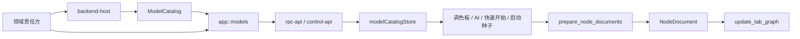

# 共享模型目录实现说明

<!-- lissio-doc
status: maintained
owner: Lissio maintainers
last-reviewed: 2026-10-07
language: zh-CN
authoritative: false
translation-of: docs/architecture/shared-model-catalog-progress.md
applies-to: Non-authoritative Chinese translation backup
-->

> 中文翻译备份；对应的英文源文件为权威版本。若中英文不一致，以英文为准。
> Chinese translation backup. The English source is authoritative; English controls in case of conflict.

本文说明前后端共享模型目录、节点创建与描述合同的当前结构。设计依据见
[`backend-model-catalog-plan.md`](backend-model-catalog-plan.md)，逐项 owner 与
wire 对照见 [`shared-model-inventory.md`](shared-model-inventory.md)。

## 结构总览

共享模型由三个层次组成：

1. **责任方定义**：`kind`、`schema_types`、`device-tree`、`llm` 等 crate 拥有参数、
   默认值、约束、端口和 lowering 语义。
2. **应用用例**：`app::models` 聚合目录，提供 `prepare_node_documents` 的创建/归一化
   与 `describe_node_documents` 的草稿端口/问题解析。
3. **出口与前端**：`control-api` / `rpc-api` 暴露统一 RPC；前端 `modelCatalogStore`
   管理目录生命周期，所有创建入口共用 `createFromCatalog`。



## 后端责任

- `data-model::model_descriptor` 拥有 `ConfigurationSchema`、`ModelCatalog`、
  `ModelDescriptor`、端口描述和模型问题等通用 wire 合同。
- `kind::widgets` 是 29 类控件的默认参数、归一化、变体、端口与 lowering 单源。
- `schema_types::preset` 提供协议预设工厂；协议端口和通道从配置与描述推导。
- `NodeDriver::display_name()` 与 `default_config()` 提供设备展示和配置默认值。
- `app::models::{catalog, prepare, describe}` 承担目录快照、创建准备和草稿描述；
  `graph_ops` 复用相同归一化、默认 handle 与端口解析。
- `backend-host` 只装配实际启用的驱动和 AI provider，不维护第二份模型白名单。

统一 RPC：

| 命令 | 语义 |
|---|---|
| `get_model_catalog` | 返回带 `contractVersion` / `revision` 的只读目录 |
| `prepare_node_documents` | 按 model/variant/configPatch 创建文档，可批量执行且不持久化 |
| `describe_node_documents` | 对草稿 documents + edges 返回端口、默认 handle、动态口和结构化问题 |

`prepare` 与 `describe` 的参数对象是整体 DTO，顶层 camelCase 字段不做参数名归一。

## 前端生命周期

- `src/store/modelCatalogStore.ts` 保存目录 revision、模型索引、加载/错误/不兼容状态
  和连接 generation。
- 后端连接、鉴权或 URL 变化都会推进 generation；迟到响应不会写入新连接。
- `BackendConnectionGate` 在目录 ready 前不挂载业务 App，避免恢复工作区或写入默认空图。
- `src/lib/models/createFromCatalog.ts` 是面板、拖放、AI、快速开始、启动种子和测试的
  共同创建入口。
- `src/lib/models/describeStore.ts` 防抖批量描述节点草稿，消费输入/输出端口、默认
  handle、动态口和问题状态。
- `WIDGET_REGISTRY` 只负责 React renderer/editor/icon；未知模型或 widget 进入
  `UnsupportedNode` 与受限属性面板。

## 类型合同

Rust wire owner 派生 `ts_rs::TS`，显式导出程序位于
`rpc-api/examples/export_contracts.rs`。`pnpm generate:contracts` 写入
`src/types/generated/`；`pnpm check:contracts` 输出到临时目录逐字比较，不修改工作区。

生成类型负责字段形状，不负责运行时校验。目录 envelope 在前端检查 revision 与结构，
业务配置最终由 Rust 解析、归一化和校验。`serde_json::Value` 只保留在开放载荷、
UI hints 或尚未收窄的边界。

## 当前边界

- `validate_adapter_configuration` 仍以单个 `DriverPayload` 校验，不能替代带真实父
  typed-port 合同的子驱动装配校验。
- 表单实现支持项目约定的 JSON Schema 子集，不承诺任意 `$ref` / `oneOf` schema。
- `minimum` 或数值 `0` 是约束，不会自动成为业务默认值。
- `SimulationConfig.encoding` 与 `DriverPayload.payload` 保留开放 JSON 载荷；它们不是
  无类型业务白名单。
- 纯 UI 常量、主题、布局、图标、i18n 和 React 交互不迁入后端目录。

## 验证

```sh
pnpm check:contracts
pnpm check:model-catalog
pnpm check:web-contract
pnpm typecheck
pnpm lint:ci
pnpm test
```

`pnpm check:model-catalog` 校验 golden fixtures、目录合同版本和 widget kind 覆盖。
新增模型、变体、wire 字段或创建语义时，必须同步更新 owner、生成合同、fixtures 与
相关测试。